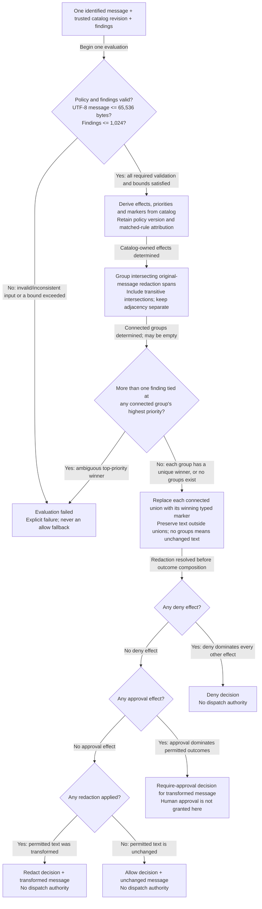
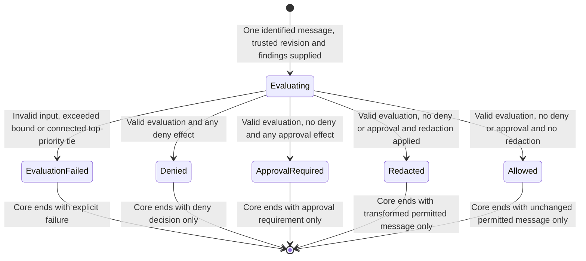

# Guard-core intent diagrams

Intent version: **v0.1**. Prepared: 2026-10-29.
Approval is recorded externally in the [confirmation record](../05-decision-record.md).
This file is a versioned review artifact, not proof of approval or implementation.
Keep subsequent as-built diagrams separate.

## 1. Sources and boundaries

- [Confirmed first-slice specification](../../../REQUIREMENTS.md#client-independent-guard-decision-core-confirmed-first-slice).
- [Scoped requirements and ambiguities](./00-ingestion.md).
- [Domain model](./01-domain-model.md).
- User-approved scope/package: DR-012.

Covered: REQ-guard-core-001 through REQ-guard-core-008 and
INV-guard-core-001 through INV-guard-core-011.

Input is one already-identified new human message plus trusted catalog revision
and findings. Actual detection and external client identity/mapping are not
performed here. Every outcome below ends core evaluation, not external execution.

## 2. Decision flow

The combined validation decision intentionally does not choose an error-code
precedence when several inputs are invalid. Exact error reporting and text-offset
representation remain AMB-guard-core-002 contract work. Every invalid case still
fails explicitly; none becomes a no-match allow.

## 3. Evaluation states

There is deliberately no Approved, Dispatched or CompletedUpstream state.
Approval authentication, cancellation, durable authorization and model delivery
belong to later slices. This boundary does not weaken those full-release gates.

## 4. Guard and branch traceability

| Branch / constraint | Scoped requirements | Domain invariants |
|---|---|---|
| One supplied message only | REQ-guard-core-001 | INV-guard-core-001 |
| Trusted policy identity/version and catalog-derived effects | REQ-guard-core-002/007 | INV-guard-core-002 |
| Valid empty findings remain no-match allow | REQ-guard-core-003 | INV-guard-core-003 |
| Valid original spans and six typed markers; outside text preserved | REQ-guard-core-004/007 | INV-guard-core-004/007 |
| Connected union, transitive intersections and separate adjacency | REQ-guard-core-005 | INV-guard-core-005/006 |
| Connected-group top-priority tie -> explicit failure | REQ-guard-core-005/007 | INV-guard-core-006/010 |
| Deny dominates approval; redactions not lost | REQ-guard-core-006 | INV-guard-core-008 |
| Approval uses already-transformed text | REQ-guard-core-004/006 | INV-guard-core-008 |
| Redact versus unchanged allow when otherwise permitted | REQ-guard-core-003/006 | INV-guard-core-009 |
| 65,536 UTF-8 bytes / 1,024 findings; any overflow fails | REQ-guard-core-007 | INV-guard-core-010 |
| No transition grants approval, identity, durability or dispatch | REQ-guard-core-008 | INV-guard-core-011 |

## 5. Approval scope and next gate

Approval of v0.1 confirms these business flow/state boundaries. It does not approve
detector patterns, implementation structure, exact result/error types, acceptance
tooling or a frozen plan. After explicit approval, author concrete scenarios
against the confirmed specification and this intent version.
