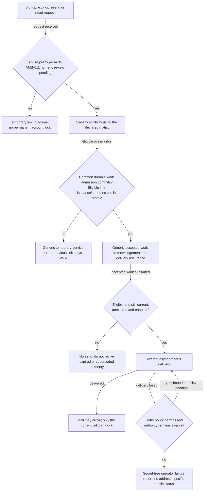
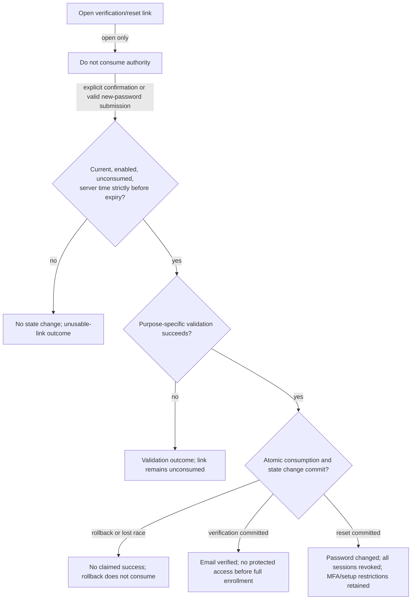
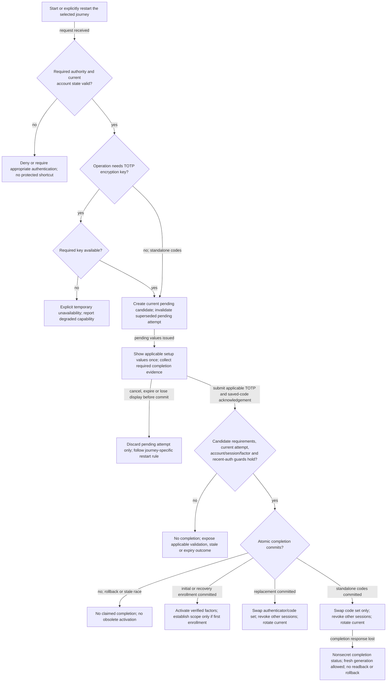
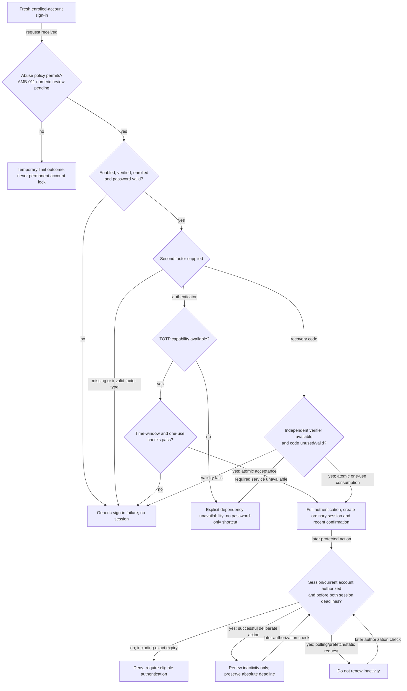
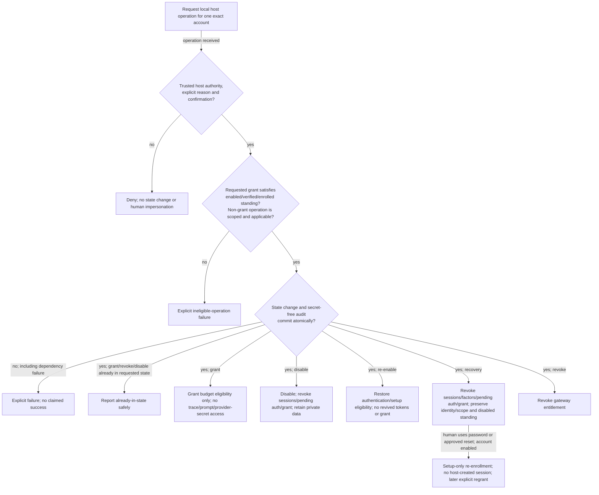
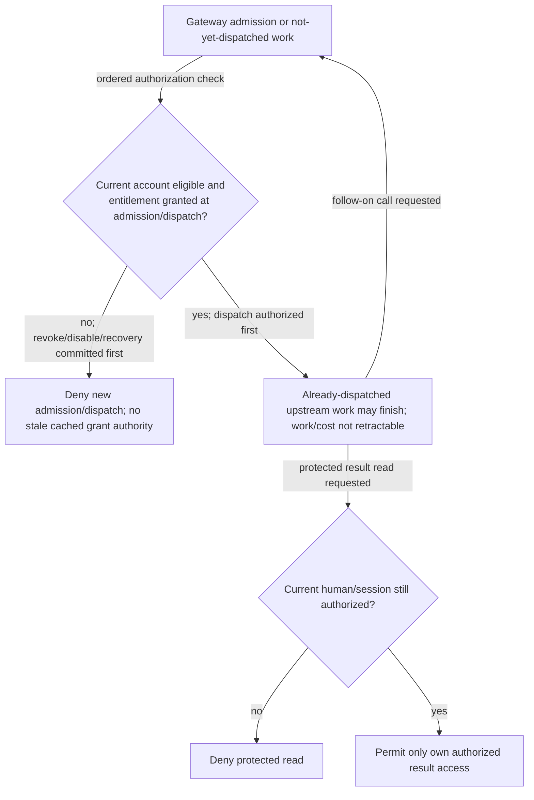

# Native authentication intent v0.1

Version: 0.1. Prepared: 2026-10-30.
Approval status is recorded in the [confirmation record](../05-decision-record.md),
not by rewriting this versioned artifact. Submission for review does not imply
approval. This artifact alone does not freeze acceptance, approve an implementation
design or authorize dependency installation. As-built diagrams must be separate.

## 1. Authority, scope and review boundary

Derived from [requirements](../../../REQUIREMENTS.md), AUTH-001 through AUTH-009
and OD-11; [decisions](../05-decision-record.md), through DR-032; the
[scoped register](./00-ingestion.md), version 0.10; and the
[domain model](./03-domain-model.md), version 0.1.
Below, `REQ-001` abbreviates `REQ-native-auth-001`, and similarly for -002 to -011.

The diagrams describe approved core behavior, not invented routes, copy,
identifiers, storage schemas or cryptographic parameters. Failure/retry paths
must preserve authority and one-use semantics; a dependency failure is never
successful completion or an incorrect-factor diagnosis.

Outstanding design/acceptance gates:

- AMB-native-auth-011: numerical abuse/delay/source and delivery/queue limits
  still require review/measurement. "Policy permits" is a visible unresolved
  guard, not a numeric acceptance oracle.
- AMB-native-auth-001 through -010/-012: concrete command/authority/audit,
  crypto/verifier/hash/rehash, cookie/CSRF/session binding, exact UI/API/copy,
  transactional/dispatch ordering and failure/retry contracts require design
  and review. None may silently change the behavior here.
- Native dependency pins, Java/Maven setup, browser/backend/mail/persistence
  harness and resource measurements are not established.
- No timeline approval controls, provider-key-management UI, workspace model,
  deletion/erasure or verified-email recycling are added.

Intent approval, if obtained, records this file's raw SHA-256 separately.
After approval, material intent changes require a new version and review.
This intent is separate from any future as-built diagram.

## 2. Mail requests and one-use confirmation

Trace: REQ-001/009/011; DR-019/020/027/028.

Eligibility is fixed, not inferred from a live response:

| Request | Eligible mail target | Other states |
|---|---|---|
| New signup | New enabled, never-verified registration | Duplicate signup changes no password/enrollment and sends no mail |
| Explicit verification resend | Enabled, never-verified registration | Generic acknowledgement; no mail |
| Password reset | Enabled, verified account, including incomplete initial enrollment | Generic acknowledgement; no mail |

Ineligible requests share admission/outage behavior without sending mail.
Old in-flight/delivered mail cannot be recalled; guide users to the newest link.
Workers recheck eligibility before each attempted send.

Verification expires after 24 hours; reset after 30 minutes. Exactly at expiry
fails. Concurrent consumption has at most one success. Issuing reset authority
does not log the human out; successful reset does.

## 3. Enrollment, replacement and standalone code regeneration

Trace: REQ-001/002/004/006/007/010; DR-021/024/025/026/027/029/030/031/032.

| Journey | Authority before starting/restarting | Completion requirements | Preserved on pre-commit interruption |
|---|---|---|---|
| Initial enrollment | Verified enabled identity with setup-only authority; explicit restart confirms password | Valid candidate TOTP plus saved-code acknowledgement; current unexpired attempt | No protected access; restart invalidates old pending values/stale attempts |
| Post-host-recovery enrollment | Enabled verified identity using password or approved reset, setup-only | Valid candidate TOTP plus saved-code acknowledgement | Existing private ownership, but no restored sessions or gateway grant |
| Authenticator replacement | Same-account/session full auth through ten minutes inclusive | Valid new TOTP, saved new codes, current attempt and still-valid recent auth | Active authenticator/code set; already-consumed authentication codes remain spent |
| Standalone code regeneration | Same-account/session full auth through ten minutes inclusive | Saved new-code acknowledgement, current attempt and still-valid recent auth | Active code set and authenticator; already-consumed authentication codes remain spent |

- Pending enrollment and standalone code sets last 24 hours.
- TOTP: six digits/30-second step, current step plus/minus one, one acceptance
  per account/time step. No replay to refresh recent confirmation.
- Recovery sets: exactly ten codes, each 128 random bits, 32 hex characters in
  eight groups of four; accept upper/lower case and optional grouping hyphens.
  Store only verifiers. No later secret readback.
- Replacement/regeneration final completion checks recent authentication again.
  Consumed authentication codes remain consumed after cancellation.
- Completion cannot restore revoked authority or extend the retained session's
  original absolute deadline. Initial scope creation is once-only; recovery
  preserves it and still needs an explicit eligible-account gateway grant.
- Password content restriction is length only, 12-128 Unicode code points.
  Preserve exact text; no extra character/encoding/composition exclusions.

## 4. Login, session activity and authenticator unavailability

Trace: REQ-002/004/005/006/008/010/011; DR-007/023/025/029/030/032.

Existing sessions do not depend on provider API-key changes or TOTP-key
availability; ordinary authorization and all other required dependencies still
apply. Key-dependent actions fail explicitly and capability is reported degraded,
not fully ready. No automatic factor/session reset, plaintext fallback or silent
replacement key. Protected key provisioning, separate backup/matched restore and
versioned same-seed rotation remain host-managed, not user re-enrollment.

Recent confirmation is valid through ten minutes inclusive, bound to the same
account/current session. Shared-session tabs share it; other sessions do not.
Sensitive completion rechecks current account/session/factor state. A valid
confirmation carried through current-session rotation keeps its original time;
rotation never extends the original absolute session deadline.

## 5. Host operations and gateway revocation

Trace: REQ-004/007/008/010; DR-022/027/032.

There is no public host-recovery/grant mechanism or bootstrap human administrator.
Concrete host authority proof, command syntax, secret-free audit schema and
dispatch/revocation ordering must be reviewed before implementation.

## 6. Approval and next gates

Review the model and transitions together. Approval of this version would approve
the bounded intent, not close numerical AMB-011 or approve an unreviewed design.
Next prepare concrete acceptance scenarios, one shared frontend/backend contract
and locator matrix, native tooling baseline, design and task lists. Resolve
blocking exact/numerical expectations before review/freeze/red acceptance/lock.

Native authentication must pass real frontend/backend acceptance before timeline
delivery uses it. No successful mocked login, forged session, unit-only
substitution or environment bypass is permitted.
