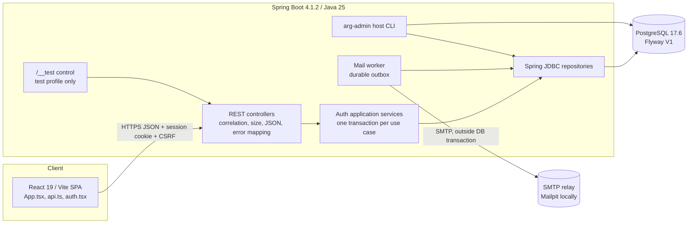
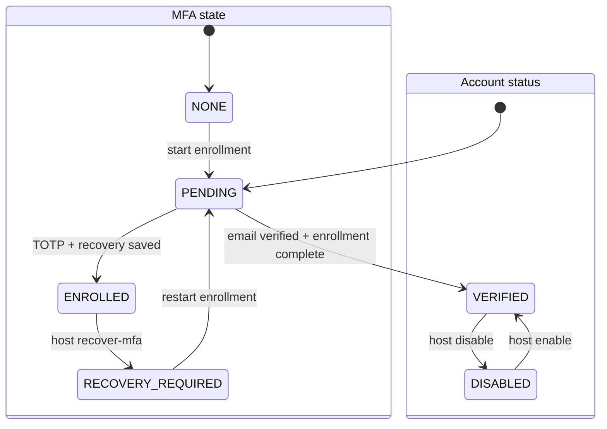
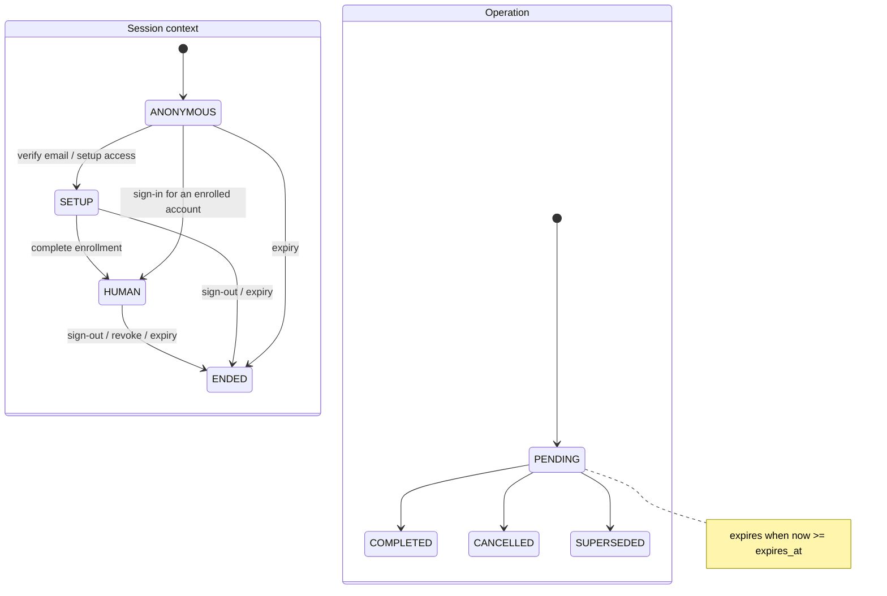
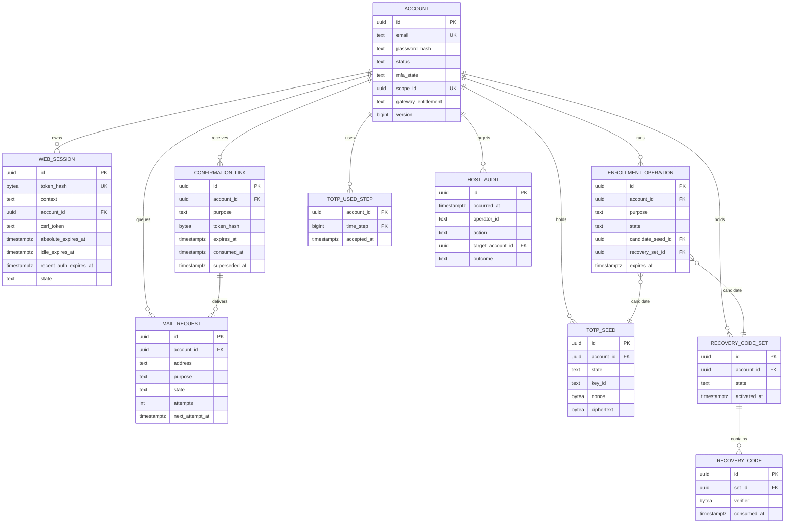

# Native-auth as-built review (Phase 12)

Status: **As-built recorded 2026-11-02; verifier note added 2026-11-03.** This
document is separate from the approved intent, design and frozen plan. It does
not modify them; it records what was built, where it deviates, and what remains
open. DR-051 later replaced Argon2id with PBKDF2-HMAC-SHA256, so the verifier
wording below is the 2026-11-02 snapshot.

Sources read for this review:

- [Implementation design](../12-implementation-design.md) (approved under DR-040)
- [Intent v0.4](../04-intent-v0.4.md) and the approved requirements
- [OpenAPI contract 0.2.1](../../../../contracts/native-auth.openapi.json)
- Backend source under `ai-runtime-governance-backend`, frontend source under
  `ai-runtime-governance-frontend`, schema
  `src/main/resources/db/migration/V1__auth_core.sql`
- [Execution evidence](../evidence/execution-evidence.md) and the
  [gap register](../evidence/gap-register.md)

## 1. As-built architecture



Implemented runtime facts:

- Frontend: React 19.3.1, Vite 8.3.5, TypeScript 5.9.3, React Router 7.18.5.
  `App.tsx` owns the routes and pages; `api.ts` owns fetch, CSRF and error
  mapping; `auth.tsx` owns the context provider.
- Backend: Java 25, Spring Boot 4.1.2, Spring MVC, Spring JDBC, Flyway.
  Virtual threads are not explicitly configured in `application.yml`.
- Persistence: PostgreSQL 17.6 locally (DR-042); the intended target remains
  18.6.
- Mail: durable `mail_request` rows plus a worker; Mailpit is the local SMTP
  sink. No real outbound email is configured.
- Host operations: `local-env/bin/arg-admin.cmd` runs the packaged jar in the
  sibling backend repository.
- Test control: `/__test` controllers exist only when
  `governance.test-control.enabled=true`, bind to loopback in the test profile,
  require the per-run token, and are absent from the OpenAPI contract.

## 2. Registration and enrollment flow

```mermaid
sequenceDiagram
  autonumber
  actor U as User
  participant S as SPA
  participant A as API
  participant D as PostgreSQL
  participant W as Mail worker
  participant M as SMTP

  U->>S: Submit email + password
  S->>A: POST /api/v1/auth/registrations
  A->>A: Normalize email; password policy; source + mail-identity limits
  A->>D: Insert account (PENDING), mail_request, confirmation_link
  A-->>S: 202 generic accepted
  W->>D: Lock one due mail_request
  W->>M: Send verification link
  U->>S: Open verification link
  S->>A: POST /api/v1/auth/email-verifications/consume
  A->>D: Lock + consume link; mark email verified; issue SETUP session
  A-->>S: 200 SETUP context
  S->>A: POST /api/v1/auth/enrollment
  A->>D: Supersede pending operation; create seed + recovery set
  A-->>S: 201 secrets shown once
  S->>A: POST /api/v1/auth/enrollment/complete (TOTP + saved codes)
  A->>D: Lock operation; verify TOTP; activate seed + recovery set; create scope; rotate HUMAN
  A-->>S: 200 HUMAN context
```

## 3. Sign-in and sensitive-change flow

```mermaid
sequenceDiagram
  autonumber
  actor U as User
  participant S as SPA
  participant A as API
  participant D as PostgreSQL

  U->>S: Email + password + authenticator code
  S->>A: POST /api/v1/auth/sign-in
  A->>A: Source/identity admission; failed-auth cooldown
  A->>D: Load account; verify Argon2; predecessor rehash CAS
  A->>D: Verify TOTP/recovery; insert totp_used_step
  A->>D: Lock account; recheck version/status/factor; issue HUMAN session
  A-->>S: 200 HUMAN context

  U->>S: Sensitive change (password / replacement / codes)
  S->>A: POST protected action
  A->>D: Read session; require HUMAN + recent auth; CSRF
  A->>D: Apply change; revoke other sessions; rotate current session
  A-->>S: 200 new context
  Note over S,A: Expired recent auth opens the modal step-up dialog first
```

## 4. State machines





The session rows also carry `recent_auth_at`/`recent_auth_expires_at`; a HUMAN
session with an expired recent-auth window can read the account but must step up
before sensitive changes.

## 5. Persistence ERD



Supporting tables not drawn: `rate_event`, `rate_bucket_state`,
`failed_auth_event`, `failed_auth_state`, `seed_key_metadata`.

## 6. Intent comparison

| Approved intent / design | As-built | Disposition |
|---|---|---|
| Public email/password registration with one-use verification | `AuthService.register`/`verify`; `confirmation_link`; generic 202 | Aligned |
| Mandatory TOTP 2FA, 6 digits, 30s, at most one adjacent step, no replay | `Totp`, `FactorVerifier`, `totp_used_step`; strict replay tests | Aligned |
| Ten one-display recovery codes, verifiers only, rotation invalidates prior set | `RecoveryCodes`, `recovery_code_set`, `recovery_code` | Aligned |
| 30-day absolute / 7-day idle / 10-minute recent auth; revocation ends sessions | `SessionService`; JUnit + real-DB supporting tests | Aligned |
| Sensitive changes require recent auth and rotate the current session | `requireRecentAuth` + `rotateForSettings`; F03 tests | Aligned |
| Host recovery/disable/enable/grant with append-only audit | `arg-admin`, `AdminService`, `host_audit` | Aligned |
| Approved mail policy 1/minute and 5/hour | `RateLimitService` defaults; isolated `test:mail-policy` evidence | Aligned; test profile intentionally relaxed |
| Exact rolling rate windows, cooldown, 429 + `Retry-After` | `RateLimitService`; SCN-084–089 | Aligned |
| Durable mail outbox, bounded retries, no SMTP inside the use-case transaction | `MailService`, `MailWorker`; Mailpit acceptance | Aligned |
| CSRF/origin/session checks; no protected shell before context resolves | `requireCsrfIfBrowser`, `SessionService`, `AuthProvider` | Aligned |
| Private scope and separate gateway entitlement | `account.scope_id`, `gateway_entitlement`; SCN tests | Aligned |
| Test-only clock/fault/cleanup/inspection controls | `TestControlController`, test profile, token, loopback | Aligned; not in OpenAPI |
| Approved UI roles/names/copy; accessible error and status regions | `App.tsx`; browser + Phase 11 a11y checks | Aligned; step-up dialog fixed |
| Timeline, guard core, gateway, provider and client integration | Not in this slice | Out of scope |

## 7. Drift register

| ID | Approved design | As-built | Consequence / disposition |
|---|---|---|---|
| AB-001 | `web_session.csrf_hash` (design §4) | `web_session.csrf_token` plaintext | A database reader can learn CSRF values but not the hashed session tokens. Not a standalone bypass, but weaker than the reviewed design. Documented deviation; candidate hardening follow-up. |
| AB-002 | Separate frontend route modules, `copy.ts`, `client.ts` (design §3, §11) | `App.tsx` contains pages and copy; `api.ts`/`auth.tsx` are the only split modules | Behavior and contract match; maintainability debt. No behavioral drift. |
| AB-003 | `SecurityConfig`/`WebConfig` in the structure (design §3) | Explicit controller/session/CSRF checks; no Spring Security configuration | Security behavior is covered by tests, but the structural departure should be reviewed before adding endpoints. |
| AB-004 | Harness split into `stack.ts`, `clock.ts`, `mail.ts`, `secrets.ts`, `host.ts`, `recording.ts` (design §14) | `api.ts`, `native-auth.ts`, `reset-hook.ts`, separate Playwright configs | Behavior covered; layout differs. Maintainability only. |
| AB-005 | Spring MVC virtual threads (technical baseline) | No explicit `spring.threads.virtual.enabled` setting | Verify the effective thread model before making throughput claims. |
| AB-006 | PostgreSQL 18.6 target | PostgreSQL 17.6 local verification (DR-042) | Accepted local deviation; 18.6 remains the target. |
| AB-007 | Exact copy in one frontend module (design §11) | Copy is inline in `App.tsx` | No observed contract drift; harder to audit. |
| AB-008 | Test-control surface absent from product API | `/__test` is test-profile-only, token-protected, loopback-only, absent from OpenAPI | Intended; no production exposure. |
| AB-009 | Step-up dialog reusable and accessible | Modal dialog with focus loop and Escape (frontend `7437262`) | Aligned after Phase 11 fix. |

## 8. Verification snapshot

| Check | Result |
|---|---|
| Browser project | 48/55 passed (original 42/49, F03 6/6) |
| API project | 52/57 passed (original 41/45, F01 3/3, F02 2/3, F03 6/6) |
| Supporting API | 4/4 |
| Mail policy | 1/1 |
| Accessibility | 4/4 |
| Backend JUnit | 10/10 |
| Guards/client | 24/24 |
| Frontend | lint, typecheck, build pass |
| Contract | valid; 57,292 bytes generated |

The remaining locked failures are the known test defects corrected by the
follow-ups: browser 001/007/015/039/054/062/094; API original
037/057/073/092 and follow-up-02 037. No remaining failure is a proven product
defect.

## 9. Open blockers and follow-ups

- Timeline Phase 6 findings R-TL-001/003/004/005 remain open; R-TL-008 is largely
  satisfied by this toolchain. Do not freeze or code the timeline before those
  decisions are reviewed.
- WSL and real client/provider integration remain user-performed and external.
- Real SMTP/provider credentials are not configured; the local acceptance sink is
  Mailpit.
- AB-001 (plaintext CSRF storage), AB-002/AB-003/AB-004 (structural/maintainability
  drift) and AB-005 (virtual-thread verification) are recorded, not silently
  accepted as complete.
- Narrow residual concurrency risks remain documented in the Phase 10 review:
  concurrent settings rotation or admin disable, and last-writer-wins password
  change.
- The main test profile keeps relaxed mail limits for setup-heavy suites; the
  approved default policy is proven only by the isolated `test:mail-policy` run.

## 10. Review statement

This as-built record was produced from the current source, schema and green
verification evidence. It does not change the approved intent, the frozen plans,
the manifests or any locked test. Drift entries are review findings, not
authorization to weaken an oracle or silently change behavior.
