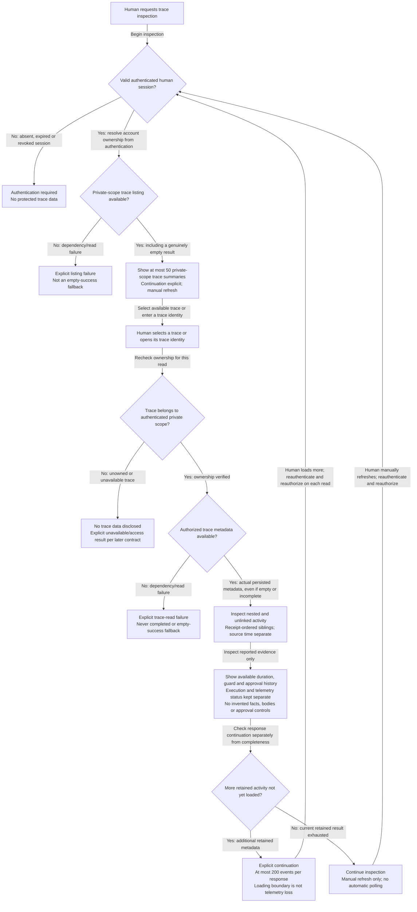
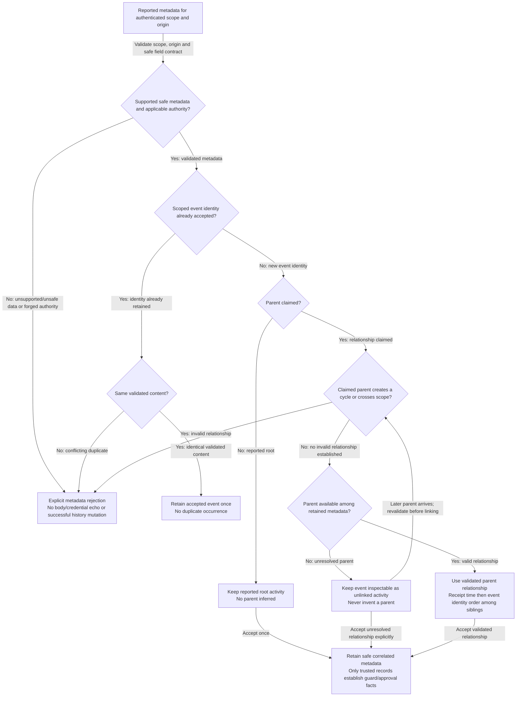

# Incident activity timeline: intent v0.1

Prepared: 2026-10-29. Version: **v0.1**.
Status of approval is recorded in the [confirmation record](../05-decision-record.md),
not by rewriting this versioned artifact. As-built diagrams must be separate.

## 1. Sources and scope

- [Confirmed timeline specification](../../../REQUIREMENTS.md#metadata-only-activity-timeline-confirmed-first-frontend-slice).
- [Scoped ingestion](./00-ingestion.md), confirmed package DR-016.
- [Pure domain model](./01-domain-model.md).
- REQ-activity-timeline-001 through REQ-activity-timeline-011.
- INV-activity-timeline-001 through INV-activity-timeline-014.

This is the read-only authenticated metadata timeline, not a prompt-submission
interface or approval console. No approval action, original/redacted prompt body,
reasoning, model/tool payload or live integration is introduced by this artifact.

## 2. Human inspection journey

The return to authorization denotes repeating checks for the selected operation,
not forcing a valid session through another login or making a detail continuation
depend on rereading the trace list. Exact routes/cursors and whether to preserve
old data during a failed refresh are later UI/contract decisions. Neither route
choice nor new visible copy is silently approved by this flow.

A direct trace identity must be authorized even when the human has not visited
the list; the selection node represents both access paths. No HTTP status or
resource-enumeration policy is invented here.

## 3. Metadata integrity and hierarchy

This is intended behavior, not a new public ingestion endpoint. Exact producer
authentication, allowed fields, payload rejection versus omission, durable
storage transaction and relinking races remain shared-contract/design work.
Missing parent data must not be confused with pagination: a parent absent from
the currently loaded response may already be retained and valid.

## 4. Independent evidence dimensions

| Dimension | Confirmed choices | Forbidden inference |
|---|---|---|
| Execution | running, completed, failed, canceled, unknown | Missing observations do not prove completion/failure |
| Telemetry | complete, incomplete, unknown, unsupported | Completed execution does not imply complete capture |
| Complete evidence | Trusted positive capture evidence required | Absence of a loss report alone is insufficient |
| Loss extent | Cause and only known count/range | Do not fill unknown counts/durations/ranges with zero |
| Loading | Explicit continuation and response bounds | Unloaded retained events are not lost telemetry |
| Input coverage | Reported enforcement/unknown/bypass state | A prompt event alone does not establish guarding |
| Response coverage | Reported observation status | A model event does not establish every response was captured |
| Tool/lifecycle coverage | Reported observation status | An observed tool call does not prove service authorization |
| Approval | Trusted requested/resolved history only | An absent result does not imply approved/rejected/expired |

These are inspection dimensions, not a newly invented approval state machine.
Exact wire enums and safe visible wording require shared contracts and scenarios.

## 5. Requirement and invariant mapping

| Responsibility | Requirements | Invariants |
|---|---|---|
| Private authenticated inspection, direct-link ownership checks | REQ-activity-timeline-001 | INV-activity-timeline-001 |
| Correlated nested/unlinked reported activity | REQ-activity-timeline-002, REQ-activity-timeline-005 | INV-activity-timeline-003/005 |
| Metadata-only prompt log | REQ-activity-timeline-003, REQ-activity-timeline-009 | INV-activity-timeline-002/013 |
| Read-only trusted approval history | REQ-activity-timeline-004 | INV-activity-timeline-008 |
| Sibling receipt order, distinct source time, available duration | REQ-activity-timeline-005 | INV-activity-timeline-004/006 |
| Execution versus completeness, genuinely empty versus unknown | REQ-activity-timeline-006, REQ-activity-timeline-007 | INV-activity-timeline-006/007 |
| Separate coverage dimensions and honest bypass | REQ-activity-timeline-008 | INV-activity-timeline-009 |
| Explicit failure rather than empty fallback | REQ-activity-timeline-010 | INV-activity-timeline-012 |
| Safe scoped duplicates and rejection of forged metadata | REQ-activity-timeline-002/004/009 | INV-activity-timeline-008/010/013 |
| 50-trace/200-event responses and explicit continuation/manual refresh | REQ-activity-timeline-005/006 | INV-activity-timeline-011 |
| Actual browser/backend/persisted controlled-data acceptance | REQ-activity-timeline-011 | INV-activity-timeline-014 |

## 6. Review gate

Approve or revise v0.1 before concrete scenarios. Approval confirms the read-only
journey, hierarchy/ordering and evidence boundaries—not exact API shapes, visible
labels, login implementation, metadata-origin enforcement or live client support.

After approval, derive browser scenarios with controlled persisted metadata and
explicit contract/copy proposals, then the shared checklist, frontend/backend
design/task lists and Phase 6 review. No freeze or implementation occurs here.
